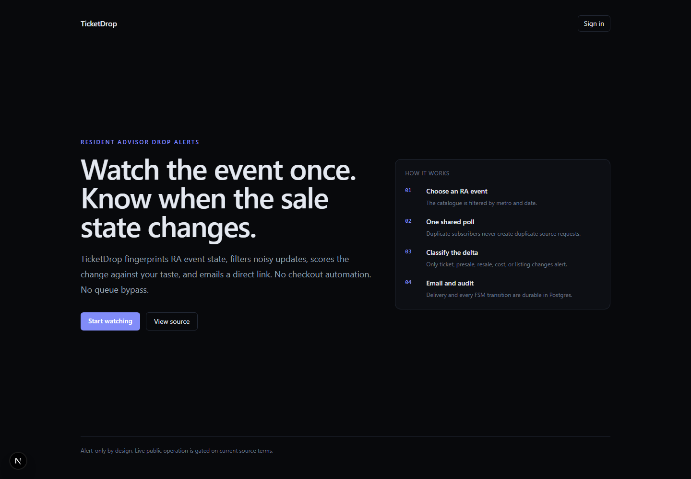

# TicketDrop

TicketDrop is an RA-only onsale-signal service. Users choose one configured
Resident Advisor metro and follow exact artist or venue names. The system polls
each watched show once, detects a classified sale-state change, and sends each
subscriber an audited email containing the RA and seller links.

[](https://github.com/gautamrn/ticketDrop/actions/workflows/ci.yml)
[](./LICENSE)

Key properties:

- The first observation is a silent baseline, not an alert.
- Source traffic scales with unique watched events, not subscriber count.
- Redis transport is at least once; Postgres constraints and a stable email
  idempotency key suppress duplicate side effects. A worker-kill load test also
  exposed a reclaim/dead-letter race that can lose alerts, so the application
  does not yet claim unconditional at-least-once completion.
- Artist and venue preferences are normalized full-name matches. There is no
  fuzzy matching.
- The product sends alerts only. It never navigates seller flows, waiting rooms,
  CAPTCHAs, payments, or purchase limits.

```text
RA catalogue → Go fingerprint/diff → Redis Stream → Python email fan-out
                       │                       │
                       └────── Postgres audit ─┘ ← Next.js user/operator views
```

Read [ARCHITECTURE.md](./ARCHITECTURE.md) for the observable RA fields,
idempotency model, latency definition, and failure modes.
Executed throughput, latency, duplicate, and worker-kill results—with raw
output—are in [docs/load-test.md](./docs/load-test.md).



## Repository layout

```text
.cursor/rules/          enforced service boundaries
db/init/                Postgres bootstrap schema
deploy/                 production proxy, monitoring, backup guidance
ingest-service/         Go RA enumeration, polling, and change detection
agent-harness/          Python subscriptions, stream worker, and email delivery
admin-panel/            Next.js authenticated product and operator UI
scripts/                product smoke and synthetic load checks
```

## Local quickstart

Prerequisites: Docker, Go 1.25, Python 3.12+, and Node.js.

```powershell
Copy-Item .env.example .env
docker compose up -d

cd agent-harness
python -m venv .venv
.\.venv\Scripts\python.exe -m pip install -e ".[dev]"
cd ..\admin-panel
npm ci
cd ..
```

Run the contract-faithful RA source:

```powershell
cd ingest-service
go run ./cmd/mock-ra -addr :8098
```

Run ingestion in another terminal. The development seed gives the availability
loop events before a user subscription is created:

```powershell
cd ingest-service
$env:RA_GRAPHQL_URL="http://localhost:8098/graphql"
$env:RA_AREAS="19"
$env:RA_DEV_SEED_WATCHLIST="3"
go run ./cmd/ingest
```

Run the worker and web app:

```powershell
cd agent-harness
.\.venv\Scripts\python.exe -m harness run

# Separate terminal
cd admin-panel
npm run dev
```

Open http://localhost:3000, sign in with the local demo account, select metro
19, and add an artist or venue preference. Without `RESEND_API_KEY`, email uses
the log adapter while still recording delivery state.

The first poll establishes a baseline. Trigger a later classified change:

```powershell
curl.exe -X POST "http://localhost:8098/admin/presale?id=90001"
curl.exe -X POST "http://localhost:8098/admin/ticketed?id=90002"
```

The repeatable container integration check is:

```powershell
docker compose -f docker-compose.verify.yml up --build --abort-on-container-exit --exit-code-from verify
```

## Security & history

`.env` has been gitignored from the first commit, no API keys appear in the
repository history, and `.env.example` carries placeholders only.

## Configuration

All services load the repository-root `.env`. The main runtime settings are:

- `DATABASE_URL`, `REDIS_URL`, and `REDIS_STREAM`;
- `RA_AREAS`, `RA_GRAPHQL_URL`, `POLL_INTERVAL_MS`, `POLL_TIMEOUT_MS`,
  `RA_WORKERS`, and `RA_ENUMERATE_INTERVAL_MS`;
- `RESEND_API_KEY`, `ALERT_FROM_EMAIL`, `APP_BASE_URL`, and
  `UNSUBSCRIBE_SECRET`;
- Auth.js provider secrets for production sign-in.

`POLL_INTERVAL_MS` defaults to 5000 and cannot be below 500. Empty `RA_AREAS`
leaves ingestion disabled. Production starts with one metro and six RA workers.
See each service README for its owned settings and endpoints.

## Verification

```powershell
cd ingest-service; go test ./...
cd ..\agent-harness
.\.venv\Scripts\ruff.exe check src tests
.\.venv\Scripts\pytest.exe -q
cd ..\admin-panel
npm run lint
npx tsc --noEmit
npm run build
```

The current synthetic stream-to-email report is in
[docs/performance.md](./docs/performance.md). It deliberately excludes RA poll
delay and network time.

## Production posture

The production profile runs Caddy, Next.js, Go, Python, Postgres, and Redis on
one VPS; only Caddy is public. Confirm RA's current terms before live public
polling. Use the labeled replay demo when live polling is not authorized.

Never commit `.env` or credentials. Review [SECURITY.md](./SECURITY.md) and
[deploy/README.md](./deploy/README.md) before deployment.
