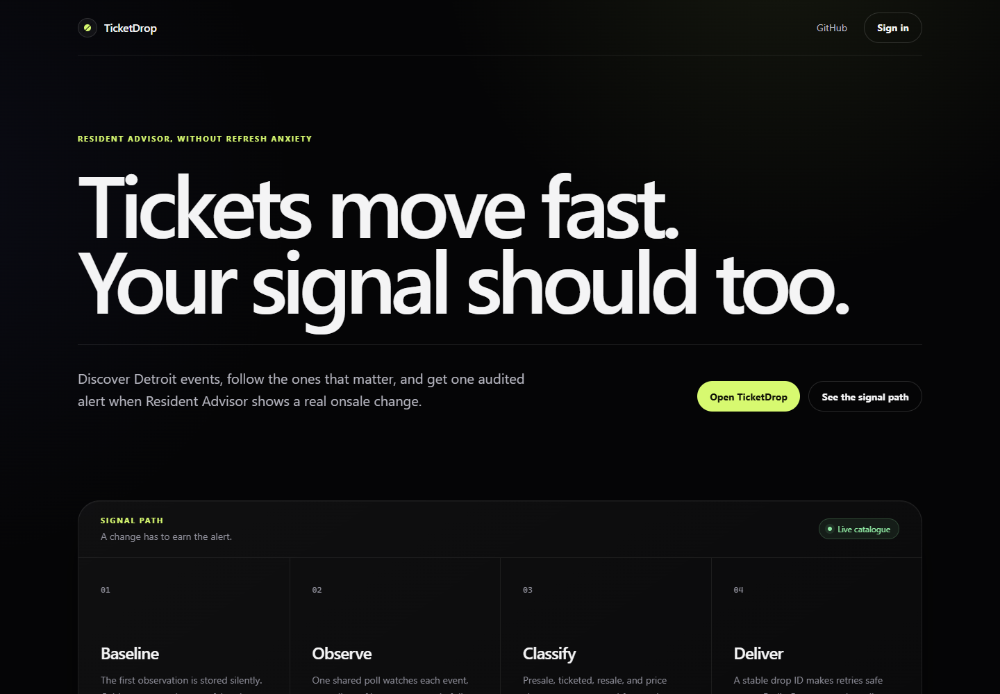
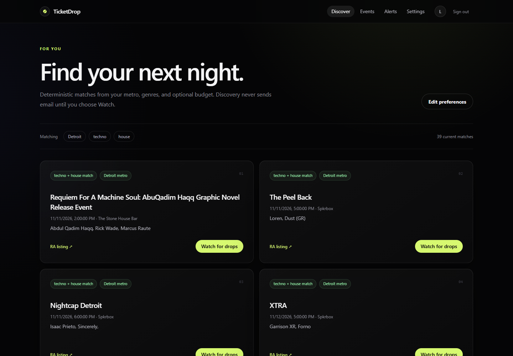
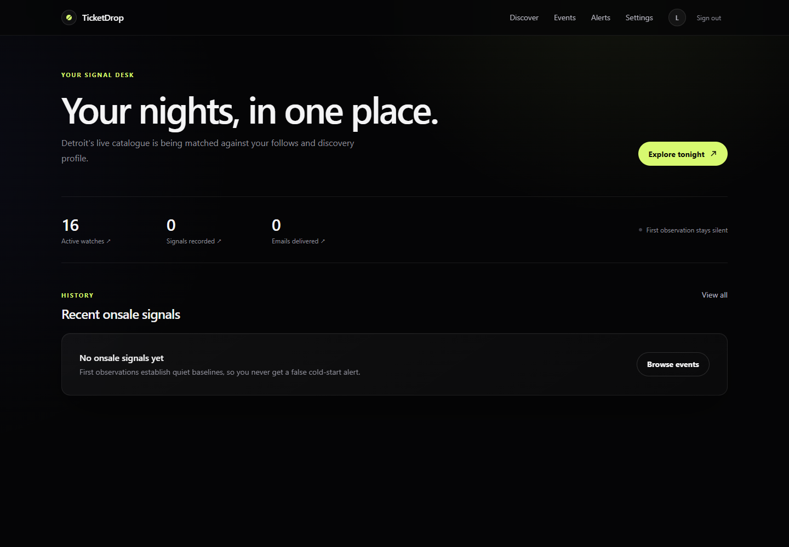
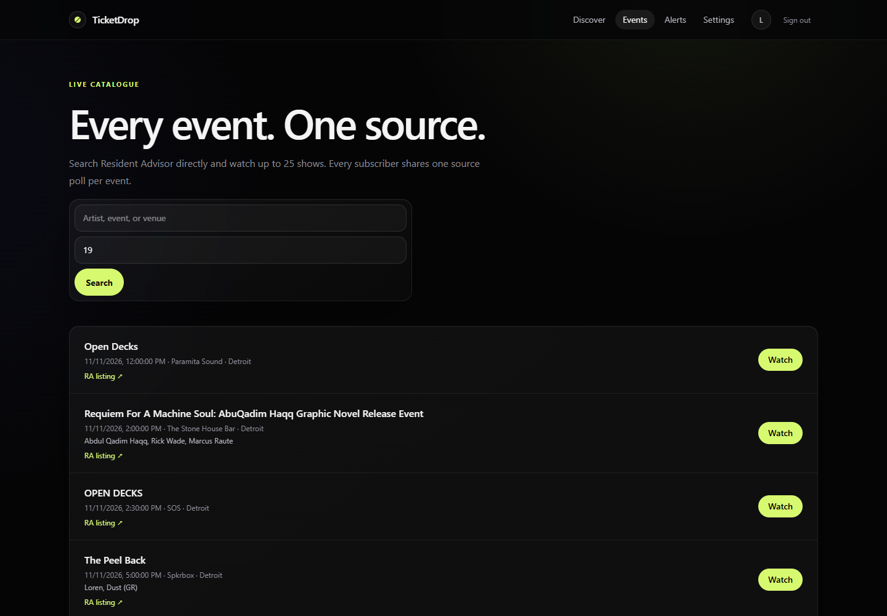

# TicketDrop

Personal event discovery and audited Resident Advisor onsale alerts.

[](https://github.com/gautamrn/ticketDrop/actions/workflows/ci.yml)
[](./LICENSE)

## What it does

- Discovers upcoming events by metro, exact RA genre, and optional price.
- Watches explicit artist, venue, or event follows through one shared source poll.
- Emails only classified presale, ticketed, resale, or listed-price changes.
- Keeps a durable transition and delivery audit in Postgres.

Discovery stays in-app. Email begins only after an explicit follow or exact-name
match, so broad preferences cannot create an alert storm.

<p>
  
  
</p>
<p>
  
  
</p>

## Why it is technically interesting

```text
RA GraphQL → Go fingerprint/diff → Postgres outbox → Redis Stream
                    │                                   │
                    └──── durable snapshots             ▼
                                               Python worker → Resend
                                                      │
                                                      ▼
                                              Postgres audit ← Next.js
```

- First sight is a silent baseline, preventing cold-start false alerts.
- Polling scales with unique events, not subscriber count.
- Redis is at-least-once; database constraints and stable provider keys suppress
  duplicate drops and intentional duplicate emails.
- Worker-kill testing found a reclaim/dead-letter loss edge. It is documented
  instead of hidden behind an exactly-once claim.
- TicketDrop never enters queues, solves CAPTCHAs, or automates checkout.

See [ARCHITECTURE.md](./ARCHITECTURE.md) for ownership and failure semantics,
and [the executed load test](./docs/load-test.md) for raw results.

## Run the real local product

Prerequisites: Docker Desktop and a Resend API key.

```powershell
Copy-Item .env.example .env
# Fill LOCAL_USER_EMAIL, RA_USER_AGENT, RESEND_API_KEY, and generated secrets.
docker compose -f docker-compose.local.yml up -d --build
```

Open [localhost:3000](http://localhost:3000). The computer and Docker must remain
running; the first observation establishes a baseline and sends no email.

For deterministic development and CI, use the mock source:

```powershell
docker compose -f docker-compose.verify.yml up --build `
  --abort-on-container-exit --exit-code-from verify
```

## Verify

```powershell
cd ingest-service; go test ./...
cd ..\agent-harness; .\.venv\Scripts\pytest.exe -q
cd ..\admin-panel; npm test; npm run lint; npm run typecheck; npm run build
```

## Repository

```text
ingest-service/   Go catalogue, polling, classification, outbox
agent-harness/    Python subscriptions, stream worker, email delivery
admin-panel/      Next.js discovery, account, alert, and operator UI
db/               Postgres contract and migrations
deploy/           Caddy, backups, and single-VPS operations
```

Production is intentionally a low-cost single-host topology, not high
availability. Review [deployment](./deploy/README.md) and
[security](./SECURITY.md) before exposing it publicly.
